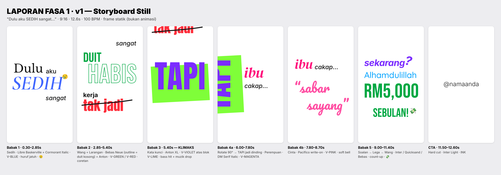

# LAPORAN FASA 1 · v1

Ujian prompt `prompt-typography-motion.md` dengan skrip contoh.

**Input yang diandaikan** (tidak diisi, jadi guna nilai lalai):

| Medan | Nilai |
|---|---|
| Nisbah | 9:16, 1080×1920, 30fps |
| Durasi sasaran | ±12s → dicadangkan **12.6s** |
| Muzik | "pilihkan" |
| Handle | `@namaanda` |
| Platform | TikTok / Reels |
| Emoji | ya-minimal, gaya **emoji flat** (Noto Color Emoji) |



---

## A. Ringkasan

| | |
|---|---|
| **Mesej utama** | Dari susah ke berjaya, dengan nasihat ibu sebagai titik pusing. |
| **Arka emosi** | Sedih → putus asa → **pusingan (TAPI)** → kasih sayang → lega → gembira/bangga |
| **BPM** | **100 BPM** (1 beat = 0.6s = 18 frame). Bahagian sedih: 1 perkataan setiap beat (0.6s). Bahagian gembira: setengah beat (0.3s). |
| **Muzik** | Satu trek "build": intro piano lembut (low-pass) → **drop** kepada beat upbeat tepat pada `TAPI` (5.40s). Tanpa vokal. |
| **Durasi** | 12.6s |
| **Babak** | 5 babak + CTA |
| **Kata kunci utama** | `TAPI`, dalam V-VIOLET atas blok V-LIME |

## B. Teks yang dibaca (sila sahkan ejaan)
```
Dulu aku SEDIH sangat
duit habis, kerja tak jadi
TAPI ibu cakap... "sabar sayang"
sekarang? Alhamdulillah, RM5,000 sebulan!
@namaanda
```

## C. Kamus Semantik Video

| Kategori | Perkataan | Font | Warna | Gerakan khas | SFX |
|---|---|---|---|---|---|
| Asas / penghubung | aku, sangat, kerja, cakap..., @namaanda | Inter Medium / Italic / Bold / Light | `INK #111111` | M3 slide-up | soft swipe |
| Tradisi / masa lalu | Dulu | Libre Baskerville | `INK` | Fade perlahan | nota piano |
| Sedih | SEDIH | Cormorant Garamond SemiBold Italic | `V-BLUE #1F4BFF` 85% | Huruf jatuh satu-satu | piano rendah |
| Wang | duit, habis, RM5,000, sebulan! | Bebas Neue | `V-GREEN #00A843` | `habis`: isi warna "mengalir keluar" jadi outline · `RM5,000`: count-up | syiling / ka-ching |
| Larangan / negatif | tak jadi | Anton | `V-RED #FF2E3B` | Pop + coretan dilukis | buzz + pen |
| Kata kunci | TAPI | Anton UPPERCASE XL | `V-VIOLET #7B2CFF` atas blok `V-LIME #7FFE39` | M5 + M10 flash → M8 rotate | bass hit + drop |
| Perempuan | ibu | DM Serif Display Italic | `V-MAGENTA #FF0F7B` | Slide lembut | soft swipe |
| Cinta | "sabar sayang" | Pacifico | `V-PINK #FF4FA3` | Write-on | soft bell |
| Soalan | sekarang? | Inter Bold Italic | `V-VIOLET #7B2CFF` | Condong masuk + `?` melantun | bloop |
| Tenang / lega | Alhamdulillah | Quicksand Medium | `V-CYAN #00A3FF` | Float naik | airy chime |

## D. Storyboard

| # | Masa (s) | Teks | Kategori | Saiz | Font | Warna | Motion | SFX | Emoji | Kamera |
|---|---|---|---|---|---|---|---|---|---|---|
| — | 0.00 | — | — | — | — | — | — | intro piano (low-pass) | — | Statik |
| 1 | 0.30 | Dulu | Tradisi | M | Libre Baskerville | INK | Fade 0.6s | nota piano | — | Tengah-kiri |
| 2 | 0.90 | aku | Penghubung | S | Inter Medium | INK | M3 | swipe -15dB | — | Kanan "Dulu" |
| 3 | 1.50 | SEDIH | Sedih | **XL** | Cormorant SB Italic | V-BLUE 85% | Huruf jatuh (stagger 60ms, 0.7s) | piano rendah | 😢 @2.10 | Bawah, rata kiri |
| 4 | 2.40 | sangat | Penghubung | S | Inter Medium Italic | INK | M3 perlahan | — | — | Rata kanan |
| — | 2.85 | — | — | — | — | — | **M7 pan ke atas** 0.4s | swipe | — | Babak 1 tolak keluar |
| 5 | 3.30 | duit | Wang | M | Bebas Neue | V-GREEN | Slam M2 | syiling | — | Kiri |
| 6 | 3.60 | habis | Wang | **XL** | Bebas Neue | V-GREEN → outline | Isi mengalir keluar 0.5s | syiling jatuh + nada turun | — | Kanan |
| 7 | 4.20 | kerja | Asas | S | Inter Bold | INK | M3 | swipe | — | Kiri |
| 8 | 4.50 | tak jadi | Larangan | M | Anton | V-RED | Pop M2 + coretan M9 (4.70–5.10) | buzz + pen | — | Kiri |
| — | 4.80 | — | — | — | — | — | — | **riser** · muzik senyap 2 frame @5.33 | — | Pan ke bawah |
| 9 | 5.40 | TAPI | Kata kunci | **XL** | Anton | V-VIOLET / blok V-LIME | M5 + M10 flash | **bass hit + drop** | ❌ (klimaks) | Penuh frame |
| — | 6.00 | — | — | — | — | — | **M8 rotate 90°** 0.45s | swoosh | — | TAPI jadi dinding kiri |
| 10 | 6.60 | ibu | Perempuan | M | DM Serif Display Italic | V-MAGENTA | Slide lembut | swipe | — | Kanan dinding |
| 11 | 7.05 | cakap... | Penghubung | S | Inter Medium Italic | INK | M3 + titik M1 | 3 × tick | — | Bawah "ibu" |
| 12 | 7.80 | "sabar sayang" | Cinta | M | Pacifico | V-PINK | Write-on 0.8s | soft bell | — | Pan kanan, dinding keluar |
| — | 8.70 | — | — | — | — | — | **M7 pan ke atas** | swipe | — | |
| 13 | 9.00 | sekarang? | Soalan | M | Inter Bold Italic | V-VIOLET | Condong + `?` melantun | bloop | — | Kiri atas |
| 14 | 9.60 | Alhamdulillah | Lega | 1.4× ⚠️ | Quicksand Medium | V-CYAN | Float 0.6s | airy chime | — | Kiri |
| 15 | 10.20 | RM5,000 | Wang | **XL** | Bebas Neue | V-GREEN | Count-up 0→5,000 (0.5s) | tick laju → **ka-ching** @10.70 | ❌ (kata XL) | Kiri |
| 16 | 10.80 | sebulan! | Wang | M | Bebas Neue | V-GREEN | M2 pop | pop | 💸 @11.00 | Kanan |
| — | 11.40 | — | — | — | — | — | **M11 hard cut** | senyap 3 frame | — | |
| 17 | 11.50 | @namaanda | Asas | S | Inter Light | INK | Statik | impact lembut | — | Tengah |
| — | 12.60 | **TAMAT** | | | | | | muzik fade 0.3s | | |

## E. Layout setiap babak
Lihat `contact-sheet.png` dan `frames/f1.png` hingga `frames/f7.png` (540×960, frame statik pada saat babak "mendarat").

## F. Kiraan emoji
**2** (😢, 💸) untuk video 12.6s. Had: ≤ 1 setiap 5s = 2. ✅
Kedua-duanya kecil (≤ 60% tinggi huruf) dan tiada pada babak klimaks atau kata XL.

## G. Semakan peraturan, risiko & soalan untuk anda

**Semakan automatik:**

| Peraturan | Status |
|---|---|
| Maks 3 keluarga font setiap frame | ✅ (kamera pan memastikan font babak lama keluar frame sebelum font baharu masuk) |
| Maks 3 warna vivid setiap frame | ✅ (babak 5: Violet + Cyan + Green) |
| Lime/Yellow bukan warna teks | ✅ (Lime hanya blok di belakang TAPI) |
| Font hiasan hanya 1–3 perkataan, saiz M ke atas | ✅ |
| Teks dibaca ≥ 0.4s | ✅ (minimum 0.6s) |

**Perkara yang saya ubah daripada contoh asal dalam prompt** (sila sahkan):
1. **💸 dipindah dari `RM5,000` ke `sebulan!`**, kerana guideline melarang emoji pada kata XL.
2. **`duit habis`**: bukan count-down ke 0 (yang akan menambah nombor yang tiada dalam skrip). Sebaliknya, warna `habis` "mengalir keluar" sehingga tinggal outline, sebagai visual dompet kosong.
3. **`Alhamdulillah`**: guna **Quicksand Medium**, bukan Light. Light terlalu nipis untuk dibaca dalam warna Cyan atas putih.

**Risiko / soalan:**
1. ⚠️ **`Alhamdulillah` terlalu panjang untuk saiz M (2×)** dalam lebar 9:16. Cadangan: guna saiz **1.4×** sebagai pengecualian (seperti dalam frame). Alternatif: kekal saiz S.
2. ⚠️ **`ibu` (Magenta) dan `sabar sayang` (Pink) dari keluarga hue yang sama**, sedangkan peraturan minta warna bersebelahan berbeza jelas. Cadangan: kekalkan, kerana baris `cakap...` (INK) memisahkan kedua-duanya dan pink dan magenta di sini memang sengaja menghubungkan "ibu ↔ kasih sayang". Alternatif: tukar `ibu` ke V-VIOLET.
3. **Bebas Neue hanya ada huruf besar**, jadi `duit habis` dan `sebulan!` akan muncul sebagai `DUIT HABIS` dan `SEBULAN!`. OK?
4. **`TAPI` dan `sekarang?` kedua-duanya Violet.** Ini sengaja: kedua-duanya titik pusing cerita. Blok Lime membezakan TAPI sebagai kata kunci utama.
5. **Muzik:** anda nak hantar trek sendiri, atau saya pilih trek bebas royalti (contoh: Pixabay Music, carian *"emotional piano to uplifting beat 100 bpm"*)?
6. **`Dulu`** saya kelaskan sebagai *Tradisi / masa lalu* (nostalgia). Jika mahu lebih neutral, tukar ke Asas (Inter).

---

> **GATE 1: BERHENTI.** Balas **`LULUS FASA 1`** untuk teruskan ke Fasa 2 (animasi + bunyi → preview), atau **beri komen** untuk v2.
