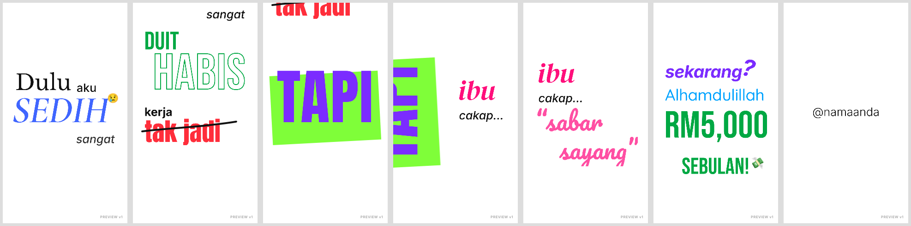

# LAPORAN FASA 2 · v1

Skrip: "Dulu aku SEDIH sangat…" · 9:16 · 12.6s · 30fps · 100 BPM

**Keputusan Gate 1:** `LULUS`. Soalan yang tidak dijawab diselesaikan ikut cadangan saya:

| Soalan | Keputusan |
|---|---|
| Saiz `Alhamdulillah` | 1.4× |
| Warna `ibu` | Kekal magenta |
| Bebas Neue huruf besar | Diterima |
| Muzik | Saya sediakan |

## A. Preview
- **Video:** `preview_v1.mp4` (540×960, H.264 + AAC 320 kbps, watermark "PREVIEW v1")
- **Sumber:** `src/`
  - `anim.html`: enjin animasi, fungsi `render(t)` per frame
  - `audio.py`: muzik + SFX
  - `rec.js`: perakam frame (Playwright)
  - `fonts/`: fail font

## B. Contact sheet

Frame yang dipaparkan: 2.70s · 5.00s · 5.70s · 7.40s · 8.65s · 11.30s · 12.00s

## C. SFX & muzik (timecode)

**Muzik:** trek asal disintesis khas untuk video ini (`audio.py`) kerana laman muzik bebas royalti disekat dalam environment ini. **Tiada isu lesen.** Boleh diganti dengan trek anda di Fasa 3.

| Bahagian | Masa | Isi |
|---|---|---|
| Intro | 0.00–5.33s | Piano sedih Am → F, arpeggio 1/8, pad lembut, low-pass. Senyap 2 frame pada 5.33s. |
| Drop | 5.40–11.40s | Upbeat C → G → Am → F → C: kick, clap, hi-hat, bass, chord stab. |
| Penutup | 11.50s | Chord C. Fade 0.3s. |

**SFX:**

| Masa | Untuk | SFX | Tahap |
|---|---|---|---|
| 0.30 | Dulu | Nota piano A3 | -2 dB |
| 0.90 | aku | Soft swipe | -15 dB |
| 1.50 | SEDIH | Piano rendah A2 | 0 dB |
| 2.85 | Pan kamera | Swipe | -12 dB |
| 3.30 | duit | Syiling (2 kali) | -6 / -9 dB |
| 3.60 | habis | Nada jatuh + 3 syiling menurun | -6 / -12 dB |
| 4.20 | kerja | Soft swipe | -15 dB |
| 4.50 | tak jadi | Buzz | -10 dB |
| 4.70 | Coretan | Pen scribble | -8 dB |
| 4.80 | — | Riser | -6 dB |
| 5.40 | **TAPI** | **Bass hit + muzik drop** (ducking -4 dB) | -2 dB |
| 6.00 | Rotate 90° | Whoosh (ducking -4 dB) | -6 dB |
| 6.60 | ibu | Swipe lembut | -14 dB |
| 7.20 / 7.30 / 7.40 | `...` | Tick × 3 | -14 dB |
| 7.50 | Pan kamera | Swipe | -14 dB |
| 7.80 | sabar sayang | Soft bell | -4 dB |
| 8.70 | Whip pan | Swipe laju | -10 dB |
| 9.20 | `?` | Bloop | -8 dB |
| 9.60 | Alhamdulillah | Airy chime (arpeggio 4 nota) | -6 dB |
| 10.20–10.64 | Count-up | Tick × 12 | -16 dB |
| 10.70 | RM5,000 | Ka-ching (loceng + syiling) | -2 / -6 dB |
| 10.80 | sebulan! | Pop | -8 dB |
| 11.50 | @namaanda | Thump lembut | -6 dB |

Emoji (😢 2.10s, 💸 11.00s): tiada SFX, ikut guideline.

## D. Font & emoji + lesen

| Item | Lesen |
|---|---|
| Inter, Libre Baskerville, Cormorant Garamond, Bebas Neue, Anton, DM Serif Display, Pacifico, Quicksand | SIL Open Font License (Google Fonts) |
| Noto Color Emoji (😢, 💸) | SIL Open Font License |
| Muzik + SFX | Disintesis sendiri, tiada lesen pihak ketiga |

## E. Perbezaan berbanding storyboard Fasa 1 (dan sebabnya)

1. **Pan kamera babak 2 = 1080px** (bukan 900). Pada 900px, bahagian bawah `SEDIH` masih nampak semasa babak 2. Ini menjadikan 4 font dalam satu frame dan melanggar had 3. Kesannya, babak 2 duduk sedikit lebih tinggi.
2. **`ibu` dianjak ke kanan** (x 430 → 560) semasa dinding TAPI ada. Ini supaya pan kamera pada 7.50s boleh tolak dinding keluar sepenuhnya sebelum `sabar sayang` (Pacifico) masuk, dan font kekal maksimum 3.
3. **`cakap...` kekal di bawah `ibu`** selepas pan, bukan di sebelahnya seperti frame f5 storyboard. Ini mengekalkan kesinambungan kamera (teks tidak melompat tempat).
4. **M10 colour flash pada TAPI:** warna teks dan blok bertukar (Lime ↔ Violet) selama 2 frame pada 5.60s.
5. **Emoji guna Noto Color Emoji** (bukan Twemoji flat), kerana CDN Twemoji disekat. Gayanya sedikit berkilat, tetapi masih satu gaya.
6. **Whip pan 8.70–9.00s** menghasilkan ±0.2s frame putih kosong sebelum `sekarang?` masuk. Ini sengaja, sebagai "nafas" sebelum babak gembira.

## F. Senarai semak QA

| # | Semakan | Status |
|---|---|---|
| 1 | Font & warna setiap perkataan sepadan dengan kamus semantik | ✅ |
| 2 | Kategori yang sama konsisten sepanjang video | ✅ (semua Wang = Bebas hijau; semua penghubung = Inter INK) |
| 3 | Maks 3 keluarga font & 3 warna vivid setiap frame | ✅ (selepas pembetulan E1 & E2) |
| 4 | Font hiasan hanya 1–3 perkataan, saiz M ke atas | ✅ |
| 5 | Emoji: ≤ 1 setiap 5s, kecil, tidak menutup teks, satu gaya | ✅ (2 emoji) |
| 6 | Semua teks boleh dibaca ≥ 0.4s | ⚠️ **`sayang”`** siap ditulis pada 8.60s, tetapi whip pan bermula 8.70s, jadi **hanya ±0.1s lengkap** di skrin. Perkataan lain ✅. |
| 7 | Tiada teks keluar safe area (kecuali teks lama yang sengaja dipotong) | ✅ |
| 8 | Lime/Yellow bukan warna teks | ✅ (kecuali flash 2 frame M10, yang memang sengaja) |
| 9 | Setiap gerakan segerak dengan beat (±2 frame) | ✅ Semua masuk pada grid 1/8 atau 1/16 beat (100 BPM). Drop tepat pada TAPI. |
| 10 | Ejaan betul 100% | ✅ |
| 11 | Loudness -14 LUFS | ✅ **-14.4 LUFS**, true peak **-1.9 dBTP** |

### Cadangan untuk isu #6 (pilih satu jika mahu dibaiki)
- **(a)** Tambah 1 beat (0.6s) selepas `sabar sayang`. Video jadi 13.2s, dan babak "ibu" dapat ruang emosi lebih.
- **(b)** Percepatkan write-on (0.3s setiap perkataan). `sayang”` dapat ±0.3s, tetapi efek tulisan tangan kurang terasa.
- **(c)** Biarkan.

---

> **GATE 2: BERHENTI.**
> Balas **`UBAH: ...`** untuk Fasa 3 (pembetulan + preview v2), atau **`RENDER`** untuk render akhir 1080×1920.
