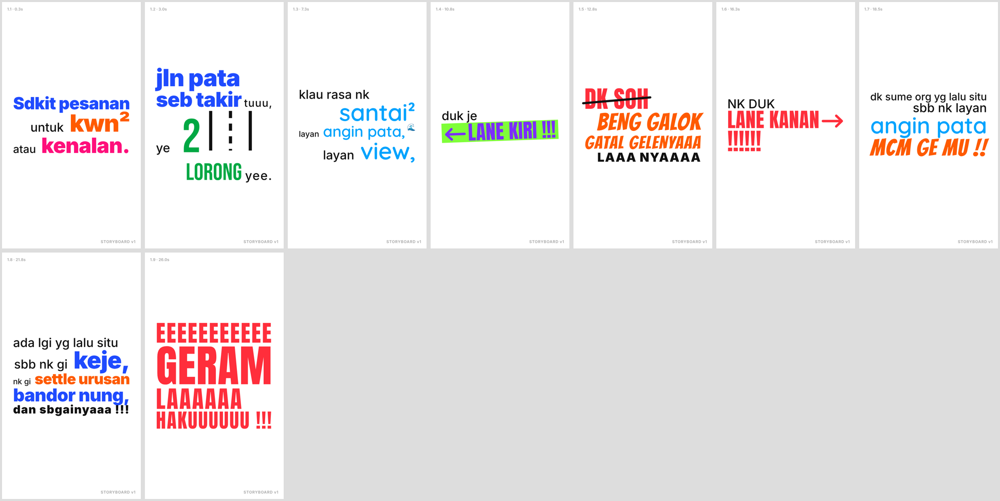
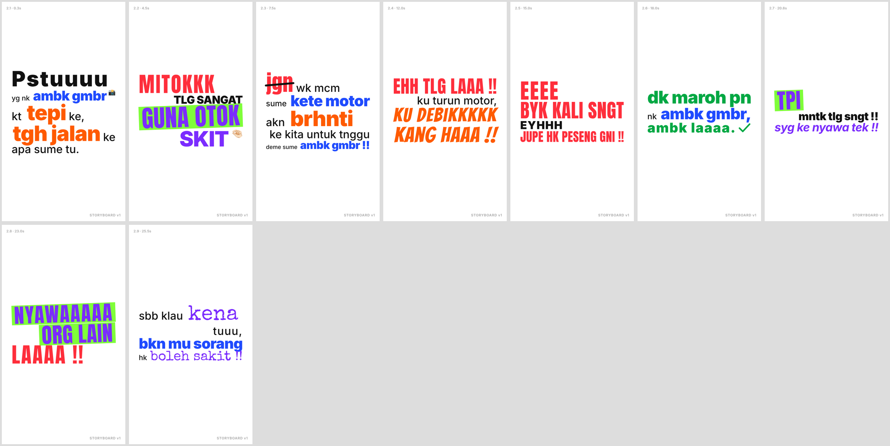
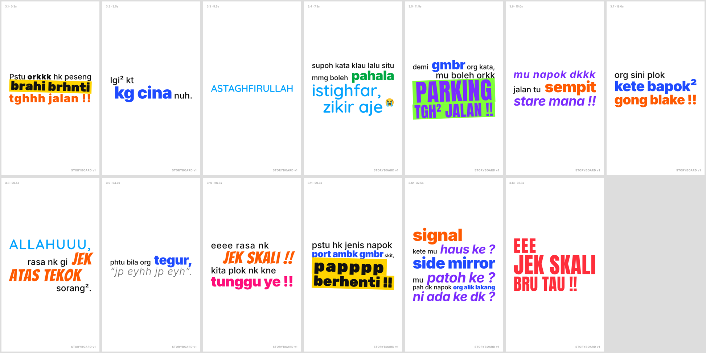

# LAPORAN FASA 1 · v1 — "Pesanan Jalan Pata"

Dijalankan dengan `prompt-typography-motion.md` atas 3 screenshot.

**Input yang diandaikan** (tidak dinyatakan):

| Medan | Nilai |
|---|---|
| Nisbah | 9:16, 1080×1920, 30fps |
| Muzik | "pilihkan" |
| Emoji | ya-minimal, emoji flat (Noto) |
| Durasi | **tidak ditetapkan → lihat soalan G1** |
| Handle / CTA | **tiada → lihat soalan G3** |

---

## A. Ringkasan

| | |
|---|---|
| **Mesej utama** | Pesanan keselamatan jalan raya, dalam nada bebel + lucu loghat Terengganu. Isinya: duduk lorong kiri kalau nak santai, jangan berhenti atau parking di tengah jalan sebab nak ambil gambar, dan fikirkan nyawa orang lain. |
| **Penutur** | Orang tempatan yang menunggang motor ("ku turun motor"). **Jantina tidak dinyatakan dalam teks, jadi tiada gaya jantina digunakan** (lihat G4). |
| **Emosi dominan** | Geram/marah yang **lucu** (bukan marah serius). Ada satu titik serius: *nyawa orang lain*. |
| **BPM** | **120 BPM** (beat 0.5s). Grid animasi 1/8 beat = 0.25s. Purata ±0.33s setiap perkataan. |
| **Muzik** | Quirky / komedi: marimba + pizzicato + kick 808. Low-pass ketika istighfar; berhenti dan tinggal heartbeat di hujung Bahagian 2. |

**Format dicadangkan: siri 3 bahagian, satu bahagian untuk setiap screenshot.**

| Bahagian | Durasi | Babak | Arka emosi |
|---|---|---|---|
| 1/3 — *Lane kiri, lane kanan* | 30.0s | 9 | Nasihat santai → perli → **GERAM** |
| 2/3 — *Guna otok skit* | 29.2s | 9 | Merayu → marah lucu → reda → **NYAWA ORG LAIN** → serius/senyap |
| 3/3 — *Parking tgh² jalan* | 40.5s | 13 | Terkejut → istighfar (ironi) → sindir → 3 soalan retorik → **JEK SKALI** |
| **Jumlah** | **±100s** | 31 | |

## B. Teks yang dibaca
Lihat **[`TRANSKRIPSI.md`](TRANSKRIPSI.md)**: teks verbatim ketiga-tiga gambar + glosari loghat. Perkataan bertanda **?** perlu disahkan.

## C. Kamus Semantik Video

| Kategori | Perkataan yang terlibat (contoh) | Font | Warna | Gerakan khas | SFX |
|---|---|---|---|---|---|
| Penghubung | yg, nk, sbb, mu, ku, kita, plok… | Inter Medium | `INK` | M3 | — |
| Maklumat | kwn², keje, settle urusan, kete motor, ambk gmbr, tepi, tgh jalan, signal, side mirror | Inter Black | Vivid ikut konteks (`V-BLUE` = gambar/kenderaan, `V-ORANGE` = lokasi/aksi) | M3 | swipe |
| Tempat | jln pata, seb takir, bandor nung, kg cina | Inter Black | `V-BLUE` | M2 pop | pop |
| Santai / alam | santai², angin pata, view | Quicksand SemiBold | `V-CYAN` | Float | angin lembut |
| Nombor | 2 lorong | Bebas Neue | `V-GREEN` | M5 + 2 garisan lorong dilukis | bass hit |
| Larangan | DK SOH, jgn | Anton | `V-RED` | Pop + pangkah | buzz + pen |
| Marah / geram | GERAM, EHH TLG LAAA, LANE KANAN, JUPE HK PESENG GNI, JEK SKALI BRU TAU | Anton UPPERCASE | `V-RED` | Shake + glitch RGB | distorted hit |
| **Kata kunci** | LANE KIRI, GUNA OTOK, tpi, NYAWAAAAA ORG LAIN, PARKING TGH² JALAN | Anton UPPERCASE | `V-VIOLET` atas blok `V-LIME` | M5 scale XL | bass hit |
| Lucu | BENG GALOK GATAL GELENYAAA, mcm ge mu, ku debikkkkk kang haaa, jek atas tekok, jek skali | Bangers | `V-ORANGE` | Wobble | boing / pow / stomp |
| Soalan / sindiran | syg ke nyawa tek, mu napok dkkk, stare mana, haus ke ?, patoh ke ?, ada ke dk ? | Inter Bold Italic | `V-VIOLET` | Condong + `?` melantun | bloop |
| Positif | dk maroh pn, ambk laaaa, pahala | Inter Black | `V-GREEN` | Pop + ✓ dilukis | ding |
| Cemas / bahaya | kena, boleh sakit | Special Elite | `V-VIOLET` | Jitter / flicker | heartbeat |
| Tenang / istighfar | ASTAGHFIRULLAH, istighfar, zikir aje, ALLAHUUU | Quicksand SemiBold | `V-CYAN` | Float perlahan, **tanpa shake/glitch/emoji** | airy chime + muzik low-pass |
| Terkejut / brek | brahi brhnti, papppp berhenti | Rubik Black | `INK` atas blok `V-YELLOW` | Zoom punch-in | **brek tayar (screech)** |
| Petikan / bisikan | "jp eyhh jp eyh" | Inter Light Italic | `INK` 60% | Typewriter perlahan | tick perlahan |

### Cadangan tambahan untuk video ini (perlu kelulusan, lihat G5)

| Cadangan | Untuk | Gerakan |
|---|---|---|
| **M12 Stretch** (gerakan baharu) | Huruf berulang: EEEEEEEEEEE, LAAAAAA, HAKUUUUUU, NYAWAAAAA, debikkkkk, tuuu | Perkataan mula padat, kemudian huruf berulang "ditarik" memanjang seiring bunyi. |
| Gerakan semantik khas | `sempit` | Huruf dihimpit |
| | `gong blake` | Teks membesar |
| | `signal` | Berkelip macam lampu signal |
| | `side mirror` | Terbalik cermin → normal |
| | `org alik lakang` | Muncul dari belakang |
| | `tunggu ye` | Huruf muncul perlahan-lahan |
| | `LANE KIRI` → `LANE KANAN` | Whip pan ke kanan (tukar lorong) |

## D. Storyboard

Masa = saat dari awal setiap bahagian.
Baris *Kamera* = permulaan babak. Setiap babak ditahan 0.25s selepas beat terakhir, kemudian kamera bergerak 0.5s.

### Bahagian 1/3 — Lane kiri, lane kanan  ·  29.9s  ·  emoji: 1

| Babak | Masa (s) | Teks | Kategori | Saiz | Font | Warna | Motion | SFX | Emoji |
|---|---|---|---|---|---|---|---|---|---|
| **1.1** | 0.25 | — | — | — | — | — | *Kamera: Mula (statik)* | — | — |
| | 0.25 | Sdkit pesanan | Maklumat | M | Inter Black | V-BLUE | M1 typewriter | tick setiap huruf | — |
| | 0.75 | untuk | Penghubung | S | Inter | INK | M3 | — | — |
| | 1.25 | kwn² | Maklumat | M | Inter Black | V-ORANGE | M3 slide-up | swipe | — |
| | 1.50 | atau | Penghubung | S | Inter | INK | M3 | — | — |
| | 1.75 | kenalan. | Maklumat | M | Inter Black | V-MAGENTA | M3 slide-up | swipe | — |
| **1.2** | 3.00 | — | — | — | — | — | *Kamera: M7 pan ke atas* | — | — |
| | 3.00 | jln pata | Tempat | M | Inter Black | V-BLUE | M2 pop | pop | — |
| | 3.50 | seb takir | Tempat | M | Inter Black | V-BLUE | M2 pop | pop | — |
| | 4.00 | tuuu, | Penghubung | S | Inter | INK | M3 | — | — |
| | 4.50 | ye | Penghubung | S | Inter | INK | M3 | — | — |
| | 4.75 | 2 | Nombor | XL | Bebas Neue | V-GREEN | M5 scale XL · 2 garisan lorong | bass hit + 2 garisan lorong dilukis | — |
| | 5.50 | lorong | Nombor | M | Bebas Neue | V-GREEN | M5 scale XL | bass hit | — |
| | 6.00 | yee. | Penghubung | S | Inter | INK | M3 | — | — |
| **1.3** | 7.25 | — | — | — | — | — | *Kamera: M7 pan ke atas* | — | — |
| | 7.25 | klau rasa nk | Penghubung | S | Inter | INK | M3 | — | — |
| | 7.75 | santai² | Santai / alam | M | Quicksand SemiBold | V-CYAN | Float naik | angin lembut | — |
| | 8.25 | layan | Penghubung | S | Inter | INK | M3 | — | — |
| | 8.75 | angin pata, | Santai / alam | M | Quicksand SemiBold | V-CYAN | Float naik | angin lembut | 🌊 |
| | 9.25 | layan | Penghubung | S | Inter | INK | M3 | — | — |
| | 9.75 | view, | Santai / alam | M | Quicksand SemiBold | V-CYAN | Float naik | angin lembut | — |
| **1.4** | 10.75 | — | — | — | — | — | *Kamera: M7 pan ke atas* | — | — |
| | 10.75 | duk je | Penghubung | S | Inter | INK | M3 | — | — |
| | 11.25 | LANE KIRI !!! | Kata kunci | XL | Anton UPPERCASE | V-VIOLET | M5 + blok V-LIME · anak panah ← | bass hit + anak panah ← dilukis | — |
| **1.5** | 12.75 | — | — | — | — | — | *Kamera: M4 whip pan ke KANAN (tukar lorong)* | — | — |
| | 12.75 | DK SOH | Larangan | M | Anton | V-RED | M2 pop + pangkah (M9) · pangkah | buzz + pen | — |
| | 13.25 | BENG GALOK | Lucu | M | Bangers | V-ORANGE | Wobble | boing | — |
| | 13.75 | GATAL GELENYAAA | Lucu | M | Bangers | V-ORANGE | Wobble + Stretch M12 | boing | — |
| | 14.75 | LAAA NYAAAA | Maklumat | S | Inter Black | INK | M3 slide-up + Stretch M12 | swipe | — |
| **1.6** | 16.25 | — | — | — | — | — | *Kamera: M7 pan ke atas* | — | — |
| | 16.25 | NK DUK | Penghubung | S | Inter | INK | M3 | — | — |
| | 16.75 | LANE KANAN | Marah / geram | XL | Anton UPPERCASE | V-RED | Shake + glitch RGB · anak panah → | distorted hit | — |
| | 17.50 | !!!!!! | Marah / geram | M | Anton UPPERCASE | V-RED | Pop satu-satu | distorted hit | — |
| **1.7** | 18.50 | — | — | — | — | — | *Kamera: M7 pan ke atas* | — | — |
| | 18.50 | dk sume org | Penghubung | S | Inter | INK | M3 | — | — |
| | 19.00 | yg lalu situ | Penghubung | S | Inter | INK | M3 | — | — |
| | 19.50 | sbb nk layan | Penghubung | S | Inter | INK | M3 | — | — |
| | 20.00 | angin pata | Santai / alam | M | Quicksand SemiBold | V-CYAN | Float naik | angin lembut | — |
| | 20.50 | mcm ge mu !! | Lucu | M | Bangers | V-ORANGE | Wobble + kenyit | boing | — |
| **1.8** | 21.75 | — | — | — | — | — | *Kamera: M7 pan ke atas (laju)* | — | — |
| | 21.75 | ada lgi yg lalu situ | Penghubung | S | Inter | INK | M3 | — | — |
| | 22.25 | sbb nk gi | Penghubung | S | Inter | INK | M3 | — | — |
| | 22.75 | keje, | Maklumat | M | Inter Black | V-BLUE | M3 slide-up | swipe | — |
| | 23.00 | nk gi | Penghubung | S | Inter | INK | M3 | — | — |
| | 23.25 | settle urusan | Maklumat | M | Inter Black | V-ORANGE | M3 slide-up | swipe | — |
| | 23.75 | bandor nung, | Tempat | M | Inter Black | V-BLUE | M2 pop | pop | — |
| | 24.25 | dan sbgainyaaa !!! | Maklumat | S | Inter Black | INK | M3 slide-up + Stretch M12 | swipe | — |
| **1.9** | 26.00 | — | — | — | — | — | *Kamera: M8 rotate 90° (klimaks)* | — | — |
| | 26.00 | EEEEEEEEEEE | Marah / geram | M | Anton UPPERCASE | V-RED | Shake + glitch RGB + Stretch M12 | riser + jeritan sintetik naik | — |
| | 26.75 | GERAM | Marah / geram | XL | Anton UPPERCASE | V-RED | Shake + glitch RGB | distorted hit + ducking | — |
| | 27.50 | LAAAAAA | Marah / geram | M | Anton UPPERCASE | V-RED | Shake + glitch RGB + Stretch M12 | distorted hit | — |
| | 28.25 | HAKUUUUUU !!! | Marah / geram | M | Anton UPPERCASE | V-RED | Shake + glitch RGB + Stretch M12 | impact + hard cut M11 | — |

### Bahagian 2/3 — Guna otok skit  ·  29.2s  ·  emoji: 2

| Babak | Masa (s) | Teks | Kategori | Saiz | Font | Warna | Motion | SFX | Emoji |
|---|---|---|---|---|---|---|---|---|---|
| **2.1** | 0.25 | — | — | — | — | — | *Kamera: Mula (statik)* | — | — |
| | 0.25 | Pstuuuu | Maklumat | M | Inter Black | INK | M3 slide-up + Stretch M12 | swipe | — |
| | 1.00 | yg nk | Penghubung | S | Inter | INK | M3 | — | — |
| | 1.25 | ambk gmbr | Maklumat | M | Inter Black | V-BLUE | M3 slide-up | swipe | 📸 |
| | 1.75 | kt | Penghubung | S | Inter | INK | M3 | — | — |
| | 2.00 | tepi | Maklumat | M | Inter Black | V-ORANGE | M3 slide-up | swipe | — |
| | 2.25 | ke, | Penghubung | S | Inter | INK | M3 | — | — |
| | 2.50 | tgh jalan | Maklumat | M | Inter Black | V-ORANGE | M3 slide-up | swipe | — |
| | 3.00 | ke | Penghubung | S | Inter | INK | M3 | — | — |
| | 3.25 | apa sume tu. | Penghubung | S | Inter | INK | M3 | — | — |
| **2.2** | 4.50 | — | — | — | — | — | *Kamera: M7 pan ke atas* | — | — |
| | 4.50 | MITOKKK | Marah / geram | M | Anton UPPERCASE | V-RED | Stretch (M12), tanpa shake | distorted hit | — |
| | 5.25 | TLG SANGAT | Maklumat | S | Inter Black | INK | M3 slide-up | swipe | — |
| | 5.75 | GUNA OTOK | Kata kunci | XL | Anton UPPERCASE | V-VIOLET | M5 + blok V-LIME | bass hit | — |
| | 6.50 | SKIT | Maklumat | M | Inter Black | V-VIOLET | M3 slide-up | swipe | 🤏🏻 |
| **2.3** | 7.50 | — | — | — | — | — | *Kamera: M7 pan ke atas* | — | — |
| | 7.50 | jgn | Larangan | M | Anton | V-RED | M2 pop + pangkah (M9) · pangkah | buzz + pen | — |
| | 7.75 | wk mcm | Penghubung | S | Inter | INK | M3 | — | — |
| | 8.25 | sume | Penghubung | S | Inter | INK | M3 | — | — |
| | 8.50 | kete motor | Maklumat | M | Inter Black | V-BLUE | M3 slide-up | swipe | — |
| | 9.00 | akn | Penghubung | S | Inter | INK | M3 | — | — |
| | 9.25 | brhnti | Maklumat | M | Inter Black | V-ORANGE | M3 slide-up | swipe | — |
| | 9.75 | ke kita untuk tnggu | Penghubung | S | Inter | INK | M3 | — | — |
| | 10.25 | deme sume | Penghubung | S | Inter | INK | M3 | — | — |
| | 10.75 | ambk gmbr !! | Maklumat | M | Inter Black | V-BLUE | M3 slide-up | swipe | — |
| **2.4** | 12.00 | — | — | — | — | — | *Kamera: M7 pan ke atas* | — | — |
| | 12.00 | EHH TLG LAAA !! | Marah / geram | M | Anton UPPERCASE | V-RED | Shake + glitch RGB | distorted hit | — |
| | 12.50 | ku turun motor, | Penghubung | S | Inter | INK | M3 | — | — |
| | 13.00 | ku debikkkkk | Lucu | M | Bangers | V-ORANGE | Wobble + Stretch M12 | boing + "pow" kartun | — |
| | 13.75 | kang haaa !! | Lucu | M | Bangers | V-ORANGE | Wobble | boing | — |
| **2.5** | 15.00 | — | — | — | — | — | *Kamera: M7 pan ke atas* | — | — |
| | 15.00 | EEEE | Marah / geram | M | Anton UPPERCASE | V-RED | Shake + glitch RGB + Stretch M12 | distorted hit | — |
| | 15.50 | BYK KALI SNGT | Marah / geram | M | Anton UPPERCASE | V-RED | Shake + glitch RGB | distorted hit | — |
| | 16.00 | EYHHH | Maklumat | S | Inter Black | INK | M3 slide-up + Stretch M12 | swipe | — |
| | 16.50 | JUPE HK PESENG GNI !! | Marah / geram | M | Anton UPPERCASE | V-RED | Shake + glitch RGB | distorted hit | — |
| **2.6** | 18.00 | — | — | — | — | — | *Kamera: M7 pan ke atas (lebih perlahan)* | — | — |
| | 18.00 | dk maroh pn | Positif / setuju | M | Inter Black | V-GREEN | M2 pop + ✓ dilukis | ding | — |
| | 18.50 | nk | Penghubung | S | Inter | INK | M3 | — | — |
| | 18.75 | ambk gmbr, | Maklumat | M | Inter Black | V-BLUE | M3 slide-up | swipe | — |
| | 19.25 | ambk laaaa. | Positif / setuju | M | Inter Black | V-GREEN | M2 pop + ✓ dilukis + Stretch M12 · ✓ | ding | — |
| **2.7** | 20.75 | — | — | — | — | — | *Kamera: M7 pan ke atas* | — | — |
| | 20.75 | tpi | Kata kunci | M | Anton UPPERCASE | V-VIOLET | M5 + blok V-LIME | bass hit | — |
| | 21.00 | mntk tlg sngt !! | Maklumat | S | Inter Black | INK | M3 slide-up | swipe | — |
| | 21.50 | syg ke nyawa tek !! | Soalan / sindiran | M | Inter Bold Italic | V-VIOLET | Condong masuk + ? melantun | bloop | — |
| **2.8** | 23.00 | — | — | — | — | — | *Kamera: M8 rotate 90° (klimaks)* | — | — |
| | 23.00 | NYAWAAAAA | Kata kunci | XL | Anton UPPERCASE | V-VIOLET | M5 + blok V-LIME + Stretch M12 | riser → bass hit | — |
| | 23.75 | ORG LAIN | Kata kunci | M | Anton UPPERCASE | V-VIOLET | M5 + blok V-LIME | bass hit | — |
| | 24.25 | LAAAA !! | Marah / geram | M | Anton UPPERCASE | V-RED | Shake + glitch RGB + Stretch M12 | distorted hit | — |
| **2.9** | 25.50 | — | — | — | — | — | *Kamera: M7 pan perlahan; muzik berhenti* | — | — |
| | 25.50 | sbb klau | Penghubung | S | Inter | INK | M3 | — | — |
| | 26.00 | kena | Cemas / bahaya | M | Special Elite | V-VIOLET | Jitter / flicker | heartbeat | — |
| | 26.50 | tuuu, | Penghubung | S | Inter | INK | M3 | — | — |
| | 27.00 | bkn mu sorang | Maklumat | M | Inter Black | V-BLUE | M3 slide-up | swipe | — |
| | 27.50 | hk | Penghubung | S | Inter | INK | M3 | — | — |
| | 27.75 | boleh sakit !! | Cemas / bahaya | M | Special Elite | V-VIOLET | Jitter / flicker | heartbeat ×2 → senyap | — |

### Bahagian 3/3 — Parking tgh² jalan  ·  40.5s  ·  emoji: 1

| Babak | Masa (s) | Teks | Kategori | Saiz | Font | Warna | Motion | SFX | Emoji |
|---|---|---|---|---|---|---|---|---|---|
| **3.1** | 0.25 | — | — | — | — | — | *Kamera: Mula (statik)* | — | — |
| | 0.25 | Pstu | Penghubung | S | Inter | INK | M3 | — | — |
| | 0.50 | orkkk | Maklumat | S | Inter Black | INK | M3 slide-up + Stretch M12 | swipe | — |
| | 1.00 | hk peseng | Penghubung | S | Inter | INK | M3 | — | — |
| | 1.50 | brahi brhnti | Terkejut / brek | M | Rubik Black | INK | Zoom punch-in + blok V-YELLOW | brek tayar (screech) | — |
| | 2.00 | tghhh jalan !! | Maklumat | M | Inter Black | V-ORANGE | M3 slide-up + Stretch M12 | swipe | — |
| **3.2** | 3.50 | — | — | — | — | — | *Kamera: M7 pan ke atas* | — | — |
| | 3.50 | lgi² | Penghubung | S | Inter | INK | M3 | — | — |
| | 3.75 | kt | Penghubung | S | Inter | INK | M3 | — | — |
| | 4.00 | kg cina | Tempat | M | Inter Black | V-BLUE | M2 pop | pop | — |
| | 4.50 | nuh. | Penghubung | S | Inter | INK | M3 | — | — |
| **3.3** | 5.50 | — | — | — | — | — | *Kamera: M7 pan perlahan; muzik low-pass* | — | — |
| | 5.50 | ASTAGHFIRULLAH | Tenang / istighfar | M | Quicksand SemiBold | V-CYAN | Float perlahan | airy chime + muzik low-pass | — |
| **3.4** | 7.25 | — | — | — | — | — | *Kamera: M7 pan ke atas* | — | — |
| | 7.25 | supoh kata | Penghubung | S | Inter | INK | M3 | — | — |
| | 7.75 | klau lalu situ | Penghubung | S | Inter | INK | M3 | — | — |
| | 8.25 | mmg boleh | Penghubung | S | Inter | INK | M3 | — | — |
| | 8.75 | pahala | Positif / setuju | M | Inter Black | V-GREEN | M2 pop + ✓ dilukis | ding | — |
| | 9.25 | istighfar, | Tenang / istighfar | M | Quicksand SemiBold | V-CYAN | Float perlahan | airy chime + muzik low-pass | — |
| | 10.00 | zikir aje | Tenang / istighfar | M | Quicksand SemiBold | V-CYAN | Float perlahan | airy chime + muzik low-pass | 😭 |
| **3.5** | 11.50 | — | — | — | — | — | *Kamera: M7 pan ke atas; muzik masuk semula* | — | — |
| | 11.50 | demi | Penghubung | S | Inter | INK | M3 | — | — |
| | 11.75 | gmbr | Maklumat | M | Inter Black | V-BLUE | M3 slide-up | swipe | — |
| | 12.00 | org kata, | Penghubung | S | Inter | INK | M3 | — | — |
| | 12.50 | mu boleh orkk | Penghubung | S | Inter | INK | M3 | — | — |
| | 13.00 | PARKING | Kata kunci | XL | Anton UPPERCASE | V-VIOLET | M5 + blok V-LIME | bass hit | — |
| | 13.75 | TGH² JALAN !! | Kata kunci | M | Anton UPPERCASE | V-VIOLET | M5 + blok V-LIME | bass hit | — |
| **3.6** | 15.00 | — | — | — | — | — | *Kamera: M7 pan ke atas* | — | — |
| | 15.00 | mu napok dkkk | Soalan / sindiran | M | Inter Bold Italic | V-VIOLET | Condong masuk + ? melantun + Stretch M12 | bloop | — |
| | 15.75 | jalan tu | Penghubung | S | Inter | INK | M3 | — | — |
| | 16.25 | sempit | Maklumat | M | Inter Black | V-ORANGE | Huruf dihimpit (squeeze) | squeak | — |
| | 16.75 | stare mana !! | Soalan / sindiran | M | Inter Bold Italic | V-VIOLET | Condong masuk + ? melantun | bloop | — |
| **3.7** | 18.00 | — | — | — | — | — | *Kamera: M7 pan ke atas* | — | — |
| | 18.00 | org sini plok | Penghubung | S | Inter | INK | M3 | — | — |
| | 18.50 | kete bapok² | Maklumat | M | Inter Black | V-BLUE | M3 slide-up | swipe | — |
| | 19.00 | gong blake !! | Maklumat | XL | Inter Black | V-ORANGE | Membesar (scale 0.5→1.15→1) | thump besar | — |
| **3.8** | 20.50 | — | — | — | — | — | *Kamera: M7 pan ke atas* | — | — |
| | 20.50 | ALLAHUUU, | Tenang / istighfar | M | Quicksand SemiBold | V-CYAN | Float perlahan + Stretch M12 | airy chime + muzik low-pass | — |
| | 21.50 | rasa nk gi | Penghubung | S | Inter | INK | M3 | — | — |
| | 22.00 | jek | Lucu | M | Bangers | V-ORANGE | Wobble | hentakan kaki (stomp) | — |
| | 22.25 | atas tekok | Lucu | M | Bangers | V-ORANGE | Wobble | boing | — |
| | 22.75 | sorang². | Penghubung | S | Inter | INK | M3 | — | — |
| **3.9** | 24.00 | — | — | — | — | — | *Kamera: M7 pan ke atas* | — | — |
| | 24.00 | phtu bila org | Penghubung | S | Inter | INK | M3 | — | — |
| | 24.50 | tegur, | Maklumat | M | Inter Black | V-BLUE | M3 slide-up | swipe | — |
| | 25.00 | “jp eyhh jp eyh”. | Petikan / bisikan | M | Inter Light Italic | INK 60% | Typewriter perlahan | tick perlahan | — |
| **3.10** | 26.50 | — | — | — | — | — | *Kamera: M7 pan ke atas* | — | — |
| | 26.50 | eeee rasa nk | Penghubung | S | Inter | INK | M3 | — | — |
| | 27.00 | jek skali !! | Lucu | M | Bangers | V-ORANGE | Wobble | stomp ×2 | — |
| | 27.50 | kita plok nk kne | Penghubung | S | Inter | INK | M3 | — | — |
| | 28.00 | tunggu ye !! | Maklumat | M | Inter Black | V-MAGENTA | Huruf muncul sangat perlahan (menunggu) | jam berdetik | — |
| **3.11** | 29.25 | — | — | — | — | — | *Kamera: M7 pan ke atas* | — | — |
| | 29.25 | pstu hk jenis napok | Penghubung | S | Inter | INK | M3 | — | — |
| | 29.75 | port ambk gmbr | Maklumat | M | Inter Black | V-BLUE | M3 slide-up | swipe | — |
| | 30.25 | skit, | Penghubung | S | Inter | INK | M3 | — | — |
| | 30.50 | papppp | Terkejut / brek | M | Rubik Black | INK | Zoom punch-in + blok V-YELLOW + Stretch M12 | brek tayar (screech) | — |
| | 31.25 | berhenti !! | Terkejut / brek | M | Rubik Black | INK | Zoom punch-in + blok V-YELLOW | brek tayar (screech) | — |
| **3.12** | 32.50 | — | — | — | — | — | *Kamera: M7 pan ke atas (laju, 3 soalan)* | — | — |
| | 32.50 | signal | Maklumat | M | Inter Black | V-ORANGE | Berkelip macam lampu signal ×2 | tik-tok signal | — |
| | 33.00 | kete mu | Penghubung | S | Inter | INK | M3 | — | — |
| | 33.50 | haus ke ? | Soalan / sindiran | M | Inter Bold Italic | V-VIOLET | Condong masuk + ? melantun | bloop | — |
| | 34.00 | side mirror | Maklumat | M | Inter Black | V-BLUE | Terbalik cermin → normal (flip) | swish | — |
| | 34.50 | mu | Penghubung | S | Inter | INK | M3 | — | — |
| | 34.75 | patoh ke ? | Soalan / sindiran | M | Inter Bold Italic | V-VIOLET | Condong masuk + ? melantun | bloop | — |
| | 35.25 | pah dk napok | Penghubung | S | Inter | INK | M3 | — | — |
| | 35.75 | org alik lakang | Maklumat | S | Inter Black | V-BLUE | Muncul dari belakang (scale 0.3→1) | swipe | — |
| | 36.50 | ni ada ke dk ? | Soalan / sindiran | M | Inter Bold Italic | V-VIOLET | Condong masuk + ? melantun | bloop | — |
| **3.13** | 37.75 | — | — | — | — | — | *Kamera: M8 rotate 90° (klimaks akhir)* | — | — |
| | 37.75 | EEE | Marah / geram | M | Anton UPPERCASE | V-RED | Shake + glitch RGB + Stretch M12 | distorted hit | — |
| | 38.25 | JEK SKALI | Marah / geram | XL | Anton UPPERCASE | V-RED | Shake + glitch RGB | stomp + distorted hit | — |
| | 39.00 | BRU TAU !! | Marah / geram | M | Anton UPPERCASE | V-RED | Shake + glitch RGB | impact + hard cut M11 | — |

## E. Layout setiap babak

Frame still (540×960): satu untuk setiap babak, ditangkap pada saat babak "mendarat". Fail individu ada dalam `frames/`.

**Bahagian 1/3**

**Bahagian 2/3**

**Bahagian 3/3**

> Still menunjukkan susunan akhir setiap babak sahaja. Dalam animasi, teks babak sebelumnya kekal terpotong di tepi frame semasa kamera bergerak (ikut guideline).

## F. Kiraan emoji

| Bahagian | Emoji | Jumlah | Had (≤ 1 setiap 5s) |
|---|---|---|---|
| 1/3 | 🌊 pada `angin pata` | 1 | 6 ✅ |
| 2/3 | 📸 pada `ambk gmbr` · 🤏🏻 pada `SKIT` (asal dari teks) | 2 | 5 ✅ |
| 3/3 | 😭 pada `zikir aje` (asal dari teks) | 1 | 8 ✅ |

- Teks asal ada pasangan `🤏🏻😭` dua kali. Saya guna satu emoji sahaja setiap kali, kerana guideline melarang emoji bertindan.
- Tiada emoji pada kata XL, kata kunci atau perkataan istighfar.

## G. Semakan peraturan, risiko & soalan

**Semakan automatik (setiap babak):**

| Peraturan | Status |
|---|---|
| Maks 3 keluarga font setiap frame | ✅ Semua 31 babak (maksimum 3 di babak 1.5, 1.7, 2.4, 3.8) |
| Maks 3 warna vivid setiap frame | ✅ Babak 3.12 asalnya ada 4 warna; `org alik lakang` ditukar ke V-BLUE |
| Lime/Yellow bukan warna teks | ✅ Hanya blok kata kunci dan blok terkejut |
| Font hiasan (Bangers, Special Elite) hanya 1–3 perkataan, saiz M ke atas | ⚠️ `BENG GALOK GATAL GELENYAAA` = 4 perkataan, dipecah kepada 2 beat (2 + 2) |
| Teks dibaca ≥ 0.4s | ✅ Setiap babak kekal di skrin sehingga babak seterusnya |
| Tempo 0.3–0.5s setiap perkataan | ✅ Purata 0.31–0.37s |

**Soalan untuk anda:**

1. **G1 · Format & durasi.** Teks panjang (±300 perkataan). Pilihan:
   - **(a)** Siri 3 bahagian (30s + 29s + 40s). **Cadangan saya**: semua teks kekal, dan setiap bahagian ada klimaks sendiri.
   - **(b)** Satu video penuh ±100s.
   - **(c)** Versi ringkas ±30s. Saya pilih ayat paling kuat (lane kiri, guna otok skit, nyawa org lain, parking tgh² jalan, jek skali) dan buang yang lain.
2. **G2 · Ejaan.** Saya kekalkan **ejaan asal & loghat** (singkatan, huruf berulang), kerana itulah "suara" dan kelucuannya. Setuju? Atau mahu ejaan standard?
3. **G3 · Penutup.** Tiada handle/CTA dalam input.
   - Nak letak `@handle` di hujung setiap bahagian?
   - Nak label siri `1/3`, `2/3`, `3/3`? Label ini akan menambah teks yang tiada dalam skrip.
4. **G4 · Jantina / suara.** Teks tidak menyatakan jantina penulis, jadi saya tidak guna gaya jantina. Jika mahu "suara" tertentu (contohnya gaya makcik bebel atau abang rider), beritahu dan saya sesuaikan font penghubung.
5. **G5 · Cadangan baharu.** Setuju dengan **M12 Stretch** dan gerakan semantik khas (bahagian C)? Jika setuju, nak saya tambah juga ke `prompt-typography-motion.md` untuk video akan datang?
6. **G6 · Perkataan agama.** `ASTAGHFIRULLAH`, `ALLAHUUU`, `istighfar` dan `zikir` saya beri gaya tenang (Quicksand cyan, float), tanpa shake, glitch atau emoji, walaupun konteksnya geram. Ia menjadi "nafas" lucu di tengah babak marah. OK?
7. **G7 · Glosari.** Sila sahkan perkataan bertanda **?** dalam `TRANSKRIPSI.md`: beng galok, peseng, orkkk, brahi, supoh, gong.
8. **G8 · Muzik.** Saya sintesis sendiri lagi (quirky 120 BPM), atau anda hantar lagu?

---

> **GATE 1: BERHENTI.** Balas **`LULUS FASA 1`** (dengan jawapan soalan jika ada) untuk teruskan ke Fasa 2, atau **beri komen** untuk v2.
