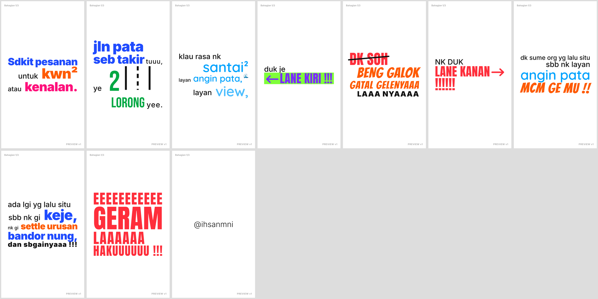
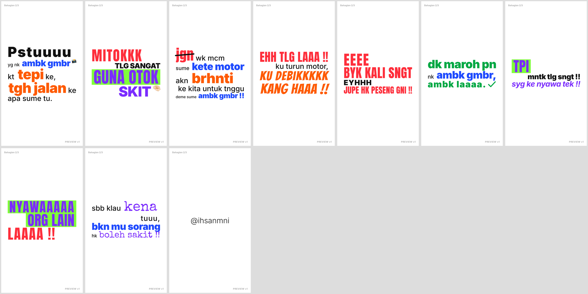
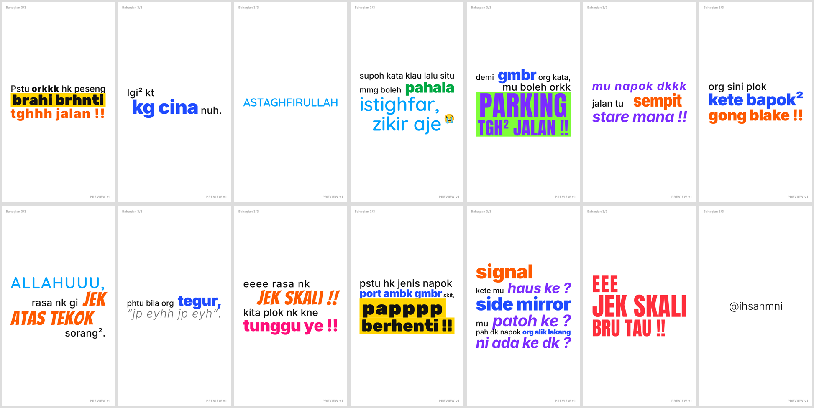

# LAPORAN FASA 2 · v1 — "Pesanan Jalan Pata"

**Keputusan Gate 1:** `LULUS`. Jawapan anda:

| Perkara | Keputusan |
|---|---|
| Format | Siri 3 bahagian |
| Penutup | `@ihsanmni` |
| Glosari | Semua betul |
| Muzik | Sintesis, gaya **kartun ceria / lucu** |
| Soalan lain | Ikut cadangan: ejaan asal, M12 Stretch, istighfar tenang, tiada gaya jantina |

## A. Preview

| Bahagian | Fail | Durasi | Loudness | True peak |
|---|---|---|---|---|
| 1/3 — Lane kiri, lane kanan | `preview_bahagian_1_v1.mp4` | 30.75s | -14.1 LUFS | -2.1 dBTP |
| 2/3 — Guna otok skit | `preview_bahagian_2_v1.mp4` | 30.00s | -14.0 LUFS | -2.1 dBTP |
| 3/3 — Parking tgh² jalan | `preview_bahagian_3_v1.mp4` | 41.25s | -14.0 LUFS | -4.3 dBTP |

- **Format fail:** 540×960, 30fps, H.264 + AAC 320 kbps, watermark "PREVIEW v1" dan label "Bahagian n/3" (preview sahaja).
- **Sumber** (`../src/`):
  - `anim.html`: enjin animasi yang membaca terus dari `storyboard.json`
  - `rec.js`: perakam frame
  - `audio.py`: muzik + SFX
  - `encode.sh`: limiter, loudness dan mux

## B. Contact sheet
Satu frame bagi setiap babak, diambil pada saat babak itu siap, ditambah frame CTA.

## C. Muzik & SFX

**Muzik:** disintesis khas, tiada lesen pihak ketiga.

| Elemen | Butiran |
|---|---|
| Tempo & kunci | 120 BPM, C major, gaya kartun |
| Instrumen | Marimba (melodi 8 bar), tuba "oom-pah" (beat 1 & 3), chord staccato (beat 2 & 4), kick, snare, shaker, glockenspiel di hujung frasa |
| Klimaks (1.9, 2.8, 3.13) | Drum fill 1s + crash |
| Bahagian 2, babak 2.9 | Muzik **berhenti**, tinggal heartbeat. Penutup: satu nota glock lembut. |
| Bahagian 3, babak 3.3–3.4 & `ALLAHUUU` | Muzik **low-pass** (istighfar) |
| Hard cut ke CTA | Senyap 3 frame, kemudian **"ta-da"** marimba (Bahagian 1 & 3) |

**SFX** (dijana automatik ikut kategori setiap beat dalam storyboard):

| Kategori / gerakan | SFX |
|---|---|
| Typewriter | tick setiap huruf |
| Kata kunci / nombor | bass hit (ducking muzik -4 dB) |
| Marah | distorted hit (ducking muzik -4 dB) |
| Larangan | buzz + coretan pen |
| Lucu | boing / "pow" / stomp |
| Soalan | bloop |
| Positif | ding |
| Cemas | heartbeat |
| Santai | angin |
| Tenang | chime |
| Terkejut | **brek tayar berdecit** |
| Khas | squeak (`sempit`) · thump besar (`gong blake`) · tik-tok (`signal`) · swish (`side mirror`) · jam berdetik (`tunggu ye`) |
| **M12 Stretch** | slide whistle naik (kartun) |
| Transisi kamera | swipe (pan) / whoosh (whip & rotate) |

Masa setiap SFX sama dengan lajur "Masa" dalam storyboard Laporan Fasa 1.

## D. Font & emoji + lesen

| Item | Lesen |
|---|---|
| Inter, Quicksand, Bebas Neue, Anton, Bangers, Special Elite, Rubik | SIL Open Font License (Google Fonts) |
| Noto Color Emoji (🌊 📸 🤏🏻 😭) | SIL Open Font License |
| Muzik + SFX | Disintesis sendiri |

## E. Perbezaan berbanding storyboard Fasa 1

1. **CTA `@ihsanmni`** ditambah di hujung setiap bahagian (1.5s, hard cut). Durasi naik ±0.75s setiap bahagian.
2. **Rotate 90° (M8)** dibuat sebagai "carousel": babak lama berpusing keluar ke kiri, babak klimaks berpusing masuk. Teks lama **tidak** ditinggalkan sebagai dinding, supaya had 3 font dan 3 warna kekal dalam setiap frame.
3. **Pan kamera** guna ease-in-out (bukan expo), supaya teks lama kelihatan bergerak keluar dan tiada frame kosong yang panjang.
4. **Ruang kosong semasa transisi:** babak baharu kosong semasa kamera bergerak (0.5s), kerana beat pertama setiap babak bermula selepas kamera mendarat.
5. **Peningkatan audio:** limiter ditambah sebelum normalisasi loudness, kerana bunyi hentakan kartun menyebabkan true peak melebihi -1 dBTP.

## F. Senarai semak QA

| # | Semakan | Status |
|---|---|---|
| 1 | Font & warna sepadan dengan kamus semantik | ✅ (dari `storyboard.json` yang sama dengan Fasa 1) |
| 2 | Kategori konsisten sepanjang 3 bahagian | ✅ (contoh: semua Marah = Anton merah, semua Lucu = Bangers oren) |
| 3 | Maks 3 font & 3 warna vivid setiap frame | ✅ (31 babak disemak; transisi rotate tidak meninggalkan teks lama) |
| 4 | Font hiasan 1–3 perkataan, saiz M ke atas | ✅ |
| 5 | Emoji ≤ 1 setiap 5s, kecil, tidak menutup teks, satu gaya | ✅ (1 / 2 / 1) |
| 6 | Teks dibaca ≥ 0.4s | ✅ (setiap babak kekal sehingga babak seterusnya; beat terakhir ≥ 0.5s) |
| 7 | Safe area | ✅ (semua baris dimuatkan dalam lebar 908px) |
| 8 | Lime/Yellow bukan warna teks | ✅ |
| 9 | Segerak dengan beat (±2 frame) | ✅ **147/147 beat** tepat pada grid 1/8 beat (0.25s) |
| 10 | Ejaan betul | ✅ Verbatim dari screenshot. Huruf besar hanya pada gaya Marah/Kata kunci. |
| 11 | Loudness -14 LUFS, true peak ≤ -1 dBTP | ✅ |

**Nota jujur:** saya tidak boleh *mendengar* audio. Muzik dan SFX disemak melalui pengukuran sahaja (loudness, profil kekuatan bunyi, senyap di 2.9, low-pass di 3.3). **Sila dengar preview** dan beritahu jika ada bunyi yang terlalu kuat, kurang lucu, atau tidak kena.

---

> **GATE 2: BERHENTI.**
> Balas **`UBAH: ...`** untuk Fasa 3 (pembetulan + preview v2), atau **`RENDER`** untuk render akhir 1080×1920 (tanpa watermark).
