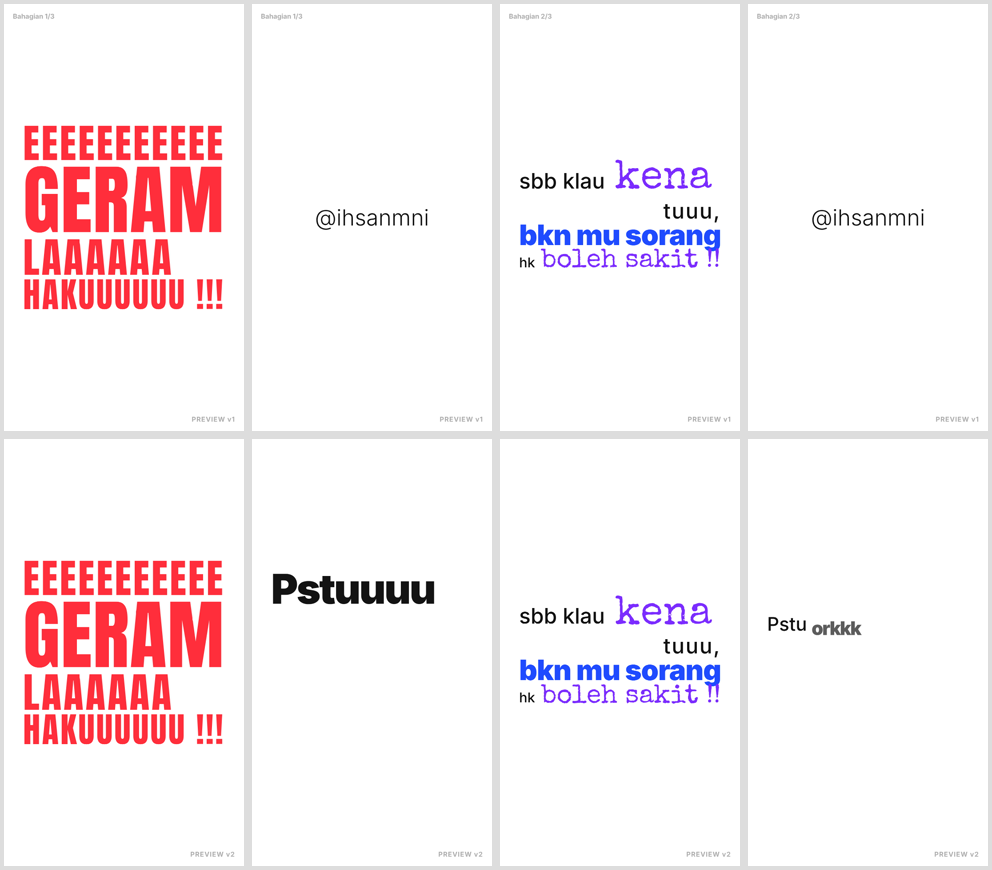

# LAPORAN FASA 3 · v2 — "Pesanan Jalan Pata" (Gabung)

## 1. Permintaan pembetulan (disahkan)

| # | Permintaan | Status |
|---|---|---|
| 1 | Gabungkan Bahagian 1, 2 dan 3 menjadi **satu video** | ✅ |
| 2 | Handle **@ihsanmni hanya sekali, di akhir video** (CTA di hujung Bahagian 1 & 2 dibuang) | ✅ |

**Tidak diubah:** teks, font, warna, gerakan, SFX, muzik dalam setiap bahagian, dan semua 31 babak.

## 2. Preview v2

| | v1 (sebelum) | **v2 (selepas)** |
|---|---|---|
| Fail | 3 video berasingan | **`preview_gabung_v2.mp4`** |
| Durasi | 30.75s + 30.00s + 41.25s | **99.0s** |
| @ihsanmni | 3 kali (hujung setiap bahagian) | **1 kali** (97.5s → 99.0s) |
| Sambungan | — | **Hard cut** pada 29.25s dan 57.75s |
| Watermark | PREVIEW v1 + label "Bahagian n/3" | PREVIEW v2 (tiada label bahagian) |

**Cara sambungan dibuat:**
- Setiap bahagian bermula **tepat di tempat CTA lamanya** dipotong.
- Ada 0.25s putih antara bahagian, kemudian babak "Mula" bahagian seterusnya terus masuk (M11 hard cut).
- Muzik bahagian lama berhenti 3 frame sebelum cut, dan muzik bahagian baharu bermula semula dari bar pertama.
- Bunyi impak (`HAKUUUUUU !!!`) dan degupan jantung (`boleh sakit !!`) dibiarkan berbunyi melepasi cut, supaya peralihan tidak terasa terputus.

| Garis masa v2 | Kandungan |
|---|---|
| 0.00 – 29.25s | Bahagian 1 — Lane kiri, lane kanan (klimaks: GERAM … HAKUUUUUU) |
| 29.25s | **Hard cut** |
| 29.25 – 57.75s | Bahagian 2 — Guna otok skit (klimaks: NYAWAAAAA ORG LAIN → senyap, heartbeat) |
| 57.75s | **Hard cut** |
| 57.75 – 97.50s | Bahagian 3 — Parking tgh² jalan (klimaks: JEK SKALI BRU TAU) |
| 97.50 – 99.00s | **@ihsanmni** + "ta-da" (satu-satunya CTA) |

## 3. Sebelum / selepas (babak yang terlibat)

- **Baris atas (v1):** hujung Bahagian 1 dan 2 terus ke @ihsanmni.
- **Baris bawah (v2):** hujung Bahagian 1 dan 2 terus ke babak pembuka bahagian seterusnya.

## 4. Semakan QA (v2)

| Semakan | Status |
|---|---|
| Hanya satu @ihsanmni, di akhir | ✅ |
| Semua 147 beat pada grid 1/8 beat (offset bahagian 29.25s & 57.75s, kedua-duanya gandaan 0.25s) | ✅ |
| Peraturan font / warna / emoji | ✅ (tidak berubah dari v1). Emoji: 4 dalam 99s (had ≤ 19). |
| Loudness | Lihat `RINGKASAN-TEKNIKAL` di bawah |

---

> **GATE 3: BERHENTI.** Balas **`UBAH: ...`** untuk pembetulan seterusnya (v3), atau **`RENDER`** untuk render akhir 1080×1920 tanpa watermark.
