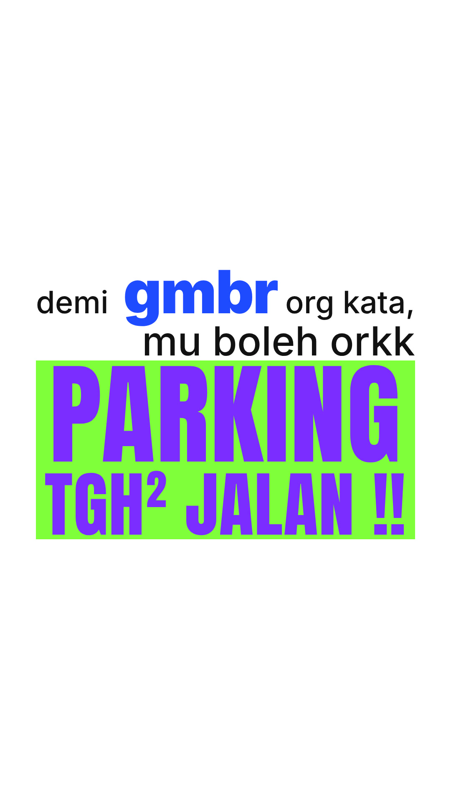

# LAPORAN FASA 4 — Render Akhir "Pesanan Jalan Pata"

**Kelulusan:** `lulus` pada GATE 3, diterima sebagai `RENDER` untuk preview v2 (gabung).

## A. Fail video akhir
**`pesanan_jalan_pata_FINAL_1080x1920.mp4`**

## B. Thumbnail / cover
**`thumbnail_1080x1920.jpg`**: babak 3.5 **PARKING TGH² JALAN** (72.15s). Ia mesej utama video, dan blok lime + ungu paling menonjol di skrin.

## C. Ringkasan teknikal

| Item | Nilai |
|---|---|
| Resolusi / fps | 1080×1920 (9:16), 30fps, 2,970 frame |
| Durasi | 99.0s |
| Video | H.264 High@4.2, yuv420p, preset slow, purata **2.9 Mbps** |
| Kualiti (PSNR vs frame asal) | Purata **77.5 dB**, minimum 66.1 dB (≥ 45 dB = tidak dapat dibezakan mata) |
| Audio | AAC 320 kbps, 48 kHz stereo |
| Loudness | **-14.0 LUFS**, true peak **-1.2 dBTP** |
| Watermark | Tiada (disahkan: piksel sudut kanan bawah putih penuh) |
| Saiz fail | 39.2 MB |
| Struktur | Bahagian 1 (0–29.25s) → hard cut → Bahagian 2 (29.25–57.75s) → hard cut → Bahagian 3 (57.75–97.5s) → **@ihsanmni** (97.5–99s) |

### ⚠️ Spesifikasi bitrate (≥ 12 Mbps) tidak dicapai secara literal

- Encoder diminta 12 Mbps, tetapi hanya menggunakan 2.9 Mbps. Kandungan video ini kebanyakannya latar putih rata dan teks tajam, jadi tidak memerlukan lebih.
- Ujian: encode hampir lossless (CRF 10) hanya perlukan 1.3 Mbps. Master 2.9 Mbps sudah **melebihi** tahap itu (PSNR 77.5 dB).
- Untuk mencapai 12 Mbps secara paksa, encoder perlu mengisi **data kosong (filler)**. Fail akan jadi ±150 MB tanpa sebarang peningkatan kualiti, dan terlalu besar untuk GitHub (had 100 MB).
- Jika platform atau klien anda mewajibkan ≥ 12 Mbps, beritahu. Saya boleh hasilkan versi CBR 12 Mbps dan hantar terus (bukan melalui repo).

### Senarai font
Inter, Quicksand, Bebas Neue, Anton, Bangers, Special Elite, Rubik. Semuanya Google Fonts, SIL Open Font License.

### Emoji
🌊 📸 🤏🏻 😭 (Noto Color Emoji, SIL OFL). Jumlah 4 dalam 99s.

### Muzik & SFX
Disintesis sendiri (`src/audio.py`), tiada lesen pihak ketiga.
- **Muzik:** kartun ceria, 120 BPM, C major (marimba, tuba oom-pah, drum ringan, glockenspiel).
- **SFX:** semua dijana ikut kategori semantik setiap beat. Senarai penuh dalam Laporan Fasa 2, bahagian C.

## D. Kamus Semantik versi akhir
**[`../KAMUS-SEMANTIK-FINAL.md`](../KAMUS-SEMANTIK-FINAL.md)**: boleh diguna semula untuk video seterusnya.

## E. Fail projek / kod sumber (boleh diedit semula)
Semua dalam `../src/`:

| Fail | Fungsi |
|---|---|
| `build.py` | Data storyboard (teks, kategori, saiz, gerakan, SFX) + pengiraan masa → `storyboard.json` |
| `combine.py` | Gabung 3 bahagian → `storyboard_gabung.json` (hard cut, @handle di akhir) |
| `layout.html` + `stills.js` | Frame still storyboard (Fasa 1) |
| `anim.html` + `rec.js` | Enjin animasi + perakam frame (`SB=storyboard_gabung.json node rec.js <dir> 0 <out> 1`) |
| `audio.py` | Muzik + SFX (`python3 audio.py <dir> 0`) |
| `encode.sh` | Limiter + loudnorm 2-pass + mux |
| `fonts/`, `fonts-local.css` | Fail font (SIL OFL) |

**Cara edit:** ubah teks atau kategori dalam `build.py` → jalankan `build.py` → `combine.py` → `rec.js` → `audio.py` → encode.
